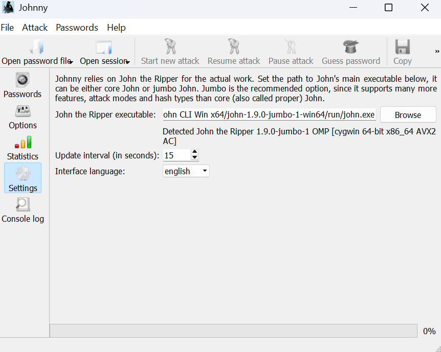
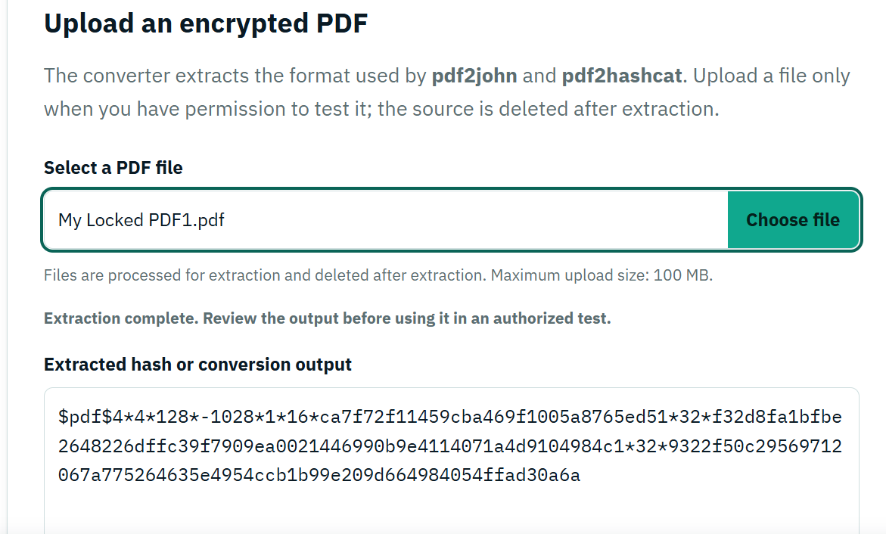
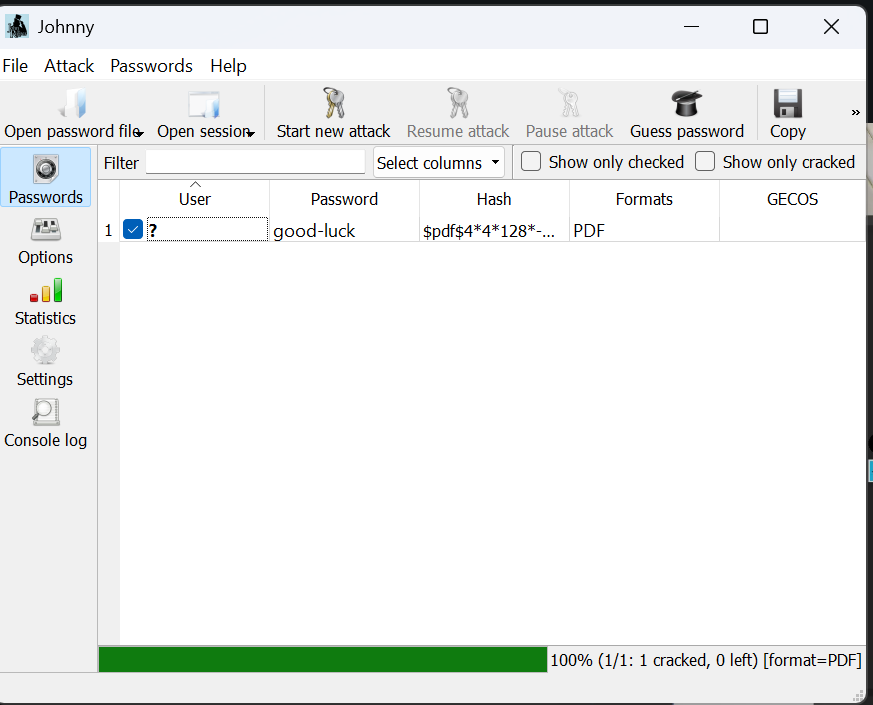
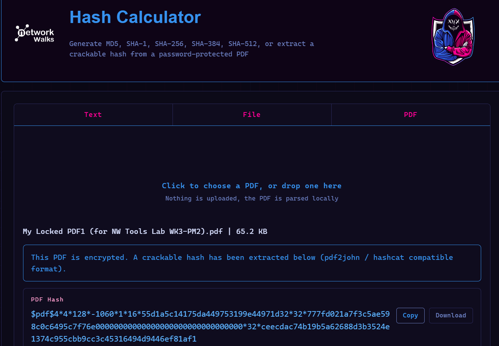
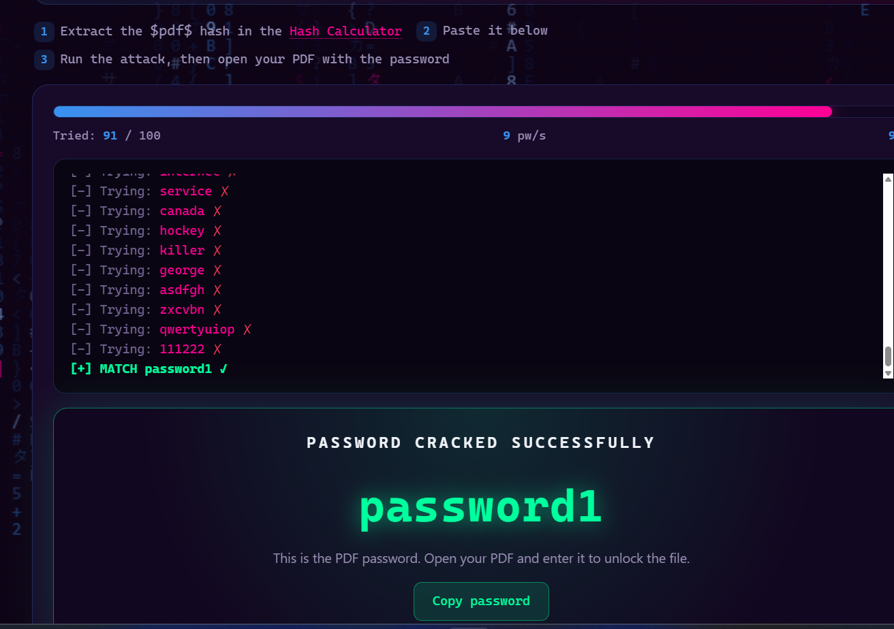

# NETWORKWALKS-ZAINAB-B084-WK3-PASSWORD-CRACKING

## Week 3 – Password Cracking

**Internship Program:** Cybersecurity & Ethical Hacking  
**Organization:** Networkwalks Academy  
**Name:** Zainab Zulfiqar  
**Batch:** B084  
**Modules:** W3-PM1 & W3-PM2

## Project Overview

During Week 3, I worked on two practical tasks focused on password recovery. Both tasks involved testing the password protection of a provided PDF file using different tools.

For the first task, I used John the Ripper with its Johnny GUI. For the second task, I used the Networkwalks Hash Calculator and Password Cracker.

These exercises helped me understand how file hashes are generated and how password recovery tools work in an authorized lab environment.

---

## 1. Password Cracking with John the Ripper (W3-PM1)

### Objective

To recover the password of the provided locked PDF file using John the Ripper and Johnny GUI.

### Step 1 – Prepare Johnny GUI

I downloaded and opened Johnny, the graphical interface for John the Ripper. I also located the `john.exe` file to make sure the application was ready to use.

### Step 2 – Extract the PDF Hash

I used the assigned hash extraction website to generate the hash of the provided encrypted PDF file. The extracted hash was then saved in a separate file so it could be used by John the Ripper.

**Screenshot 1: Johnny GUI Opened**

**Screenshot 2: Extracted PDF Hash Saved in a File**

### Step 3 – Recover the Password

I loaded the saved hash into John the Ripper and performed the password recovery process. After the tool identified the password, I used it to access the protected PDF file.

**Screenshot 3: Password Recovered Using John the Ripper**

**Screenshot 4: PDF Successfully Unlocked**

### Result

The password was successfully recovered, and I was able to open the provided PDF file.

---

## 2. Password Cracking with Networkwalks Tools (W3-PM2)

### Objective

To recover the password of the same provided PDF file using the Networkwalks Hash Calculator and Password Cracker tools.

### Step 1 – Calculate the File Hash

I opened the Networkwalks Hash Calculator and uploaded the provided PDF file to generate its hash. The calculated hash was used in the next step.

**Screenshot 5: Hash Generated Using Networkwalks Hash Calculator**

### Step 2 – Recover the Password

I entered the generated hash into the Networkwalks Password Cracker and performed the recovery process. The tool returned the recovered password.

**Screenshot 6: Password Recovered Using Networkwalks Password Cracker**

### Step 3 – Verify the Password

Finally, I entered the recovered password into the locked PDF file to verify that it could be opened successfully.

**Screenshot 7: PDF Successfully Unlocked Using Networkwalks Tools**

### Result

The PDF file was successfully unlocked using the Networkwalks tools.

---

## Learning Outcomes

Through these two practical tasks, I learned:

- How password-protected PDF files can be tested.
- How hashes are generated from files.
- How John the Ripper and Johnny GUI support password auditing.
- How to use Networkwalks Hash Calculator and Password Cracker.
- How to verify password recovery by opening a protected file.
- The importance of strong passwords in file security.

## Conclusion

Week 3 gave me practical experience with two different password recovery approaches. I used John the Ripper and Networkwalks tools to work with file hashes and recover the password of a protected PDF.

These tasks helped me understand the basic process of password auditing and why strong passwords are important for protecting files. All activities were completed as part of the assigned educational exercises.

---

**Submitted by:** Zainab Zulfiqar  
**Program:** Cybersecurity & Ethical Hacking  
**Organization:** Networkwalks Academy  
**Batch:** B084  
**Week:** 03
